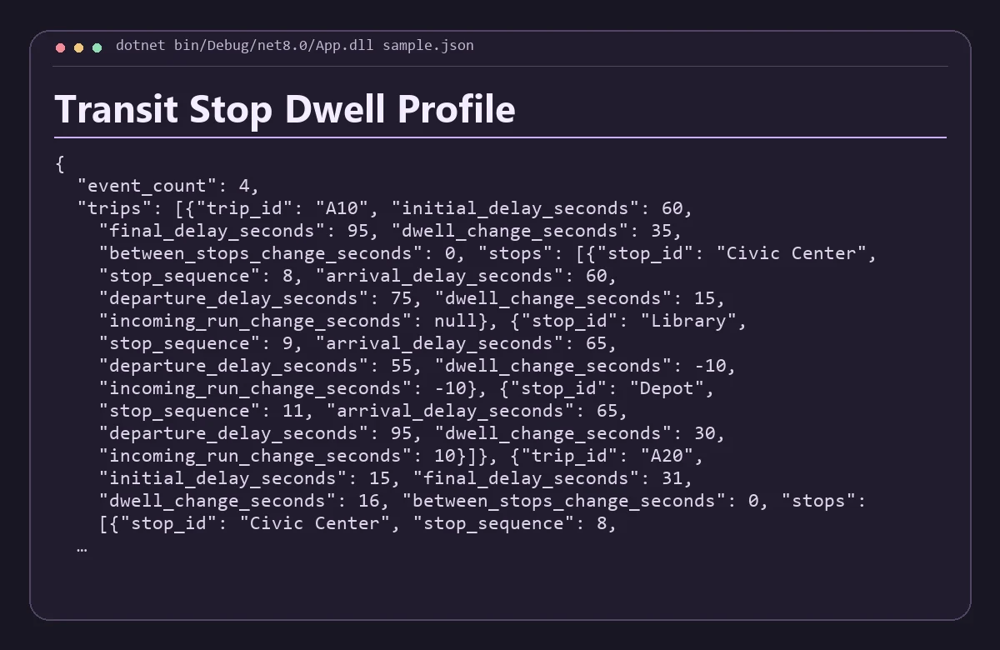

# Transit Stop Dwell Profile

Break a transit trip’s change in schedule delay into time gained or lost at each stop and between stops.



## Run

Install .NET 8 SDK and runtime. Run these commands from the repository root.

```sh
dotnet build --nologo
dotnet bin/Debug/net8.0/App.dll sample.json
```

Replace `sample.json` with a JSON file following the same structure. The app prints a JSON report to standard output.

Enter one event per stop visit. The trip ID and positive stop sequence identify a visit, so loop routes can repeat a stop at different sequences. Use ISO 8601 timestamps with seconds and a UTC offset or Z. Dwell change compares actual time at a stop with the planned time. Incoming run change compares the elapsed time since the previous observed stop with the planned time between the same stops. Positive change adds delay and negative change gains time.

## Verify

Run `python check.py` with Python 3.11 or newer after the build step when applicable. The check verifies the bundled scenario and confirms that an invalid input returns an error.
